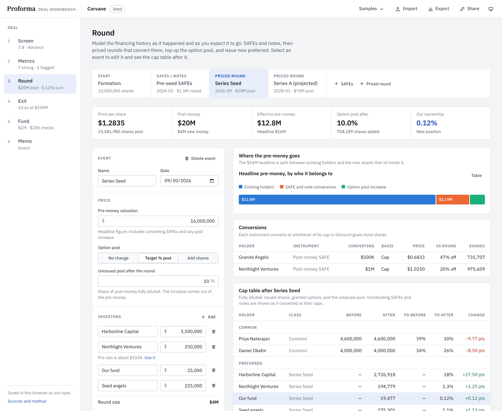
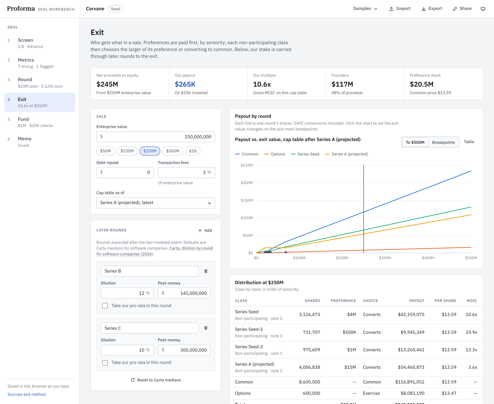
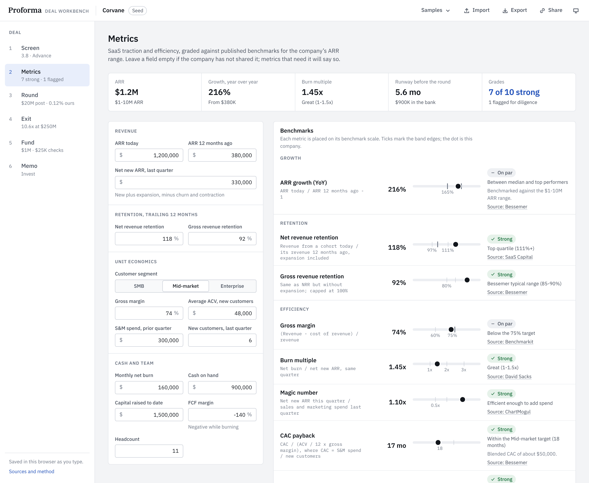
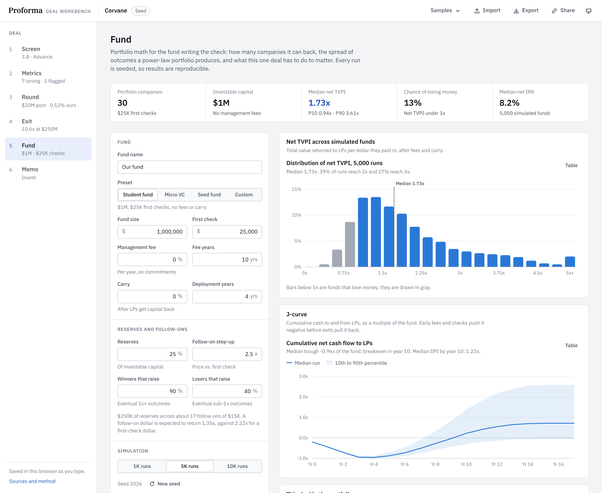
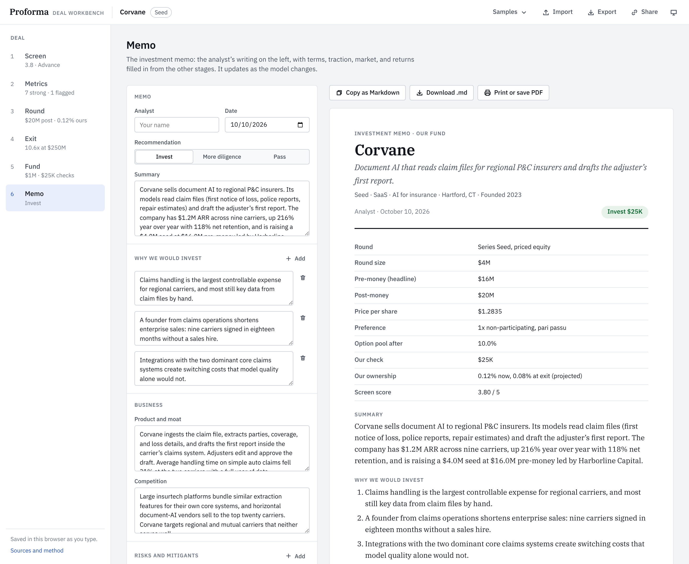

# Proforma

A venture deal workbench for early-stage SaaS investing. One deal flows through six stages: a first-pass screen, SaaS metrics graded against published benchmarks, the financing history (SAFEs, notes, and priced rounds) with a pro forma cap table, the liquidation waterfall at exit, the fund-level math, and an investment memo assembled from all of it.

Everything runs in the browser. The calculation engine is plain TypeScript with no UI dependencies, and it is tested against Y Combinator's published SAFE examples and with property-based tests.

<!-- Live demo: add the GitHub Pages URL here after the first deploy. -->



## The six stages

| Stage       | What it does                                                                                                                                                                                                                                                                                            |
| ----------- | ------------------------------------------------------------------------------------------------------------------------------------------------------------------------------------------------------------------------------------------------------------------------------------------------------- |
| **Screen**  | Thesis-fit checks (required checks gate the deal), a weighted 1–5 scorecard with a recommendation, and bottom-up TAM / SAM / SOM with the share of SAM needed to reach $100M ARR.                                                                                                                       |
| **Metrics** | Twelve SaaS metrics, including burn multiple, NRR, CAC payback, magic number, and cash conversion score, each placed on a benchmark scale for the company's ARR range, with the source cited. ARR projection with growth decay against the T2D3 path.                                                   |
| **Round**   | Post-money and pre-money SAFEs, convertible notes with interest, and priced rounds with an option pool target, pro rata, and preferred terms. Shows conversion prices, the effective pre-money after the option pool shuffle, before/after ownership, and a VC-method valuation check.                  |
| **Exit**    | Liquidation waterfall with seniority, 1x/2x preferences, non-participating, participating, and capped preferred, option strike prices, and unconverted SAFEs. Finds each class's conversion choice and every breakpoint, then carries our stake through later rounds to the exit that returns the fund. |
| **Fund**    | Seeded Monte Carlo of a fund: fees, European carry, reserves, follow-ons at a step-up, and an outcome distribution anchored to Correlation Ventures data. Net TVPI distribution, DPI, J-curve, IRR, and power-law statistics.                                                                           |
| **Memo**    | An investment memo with terms, traction, market, returns, and risks filled in from the model. Copy as Markdown or print to PDF.                                                                                                                                                                         |

Two fictional sample deals are included: **Corvane**, a seed round that converts pre-seed SAFEs, and **Mossgrove**, a pre-seed raise on post-money SAFEs.

## How the math is checked

- **92 tests** (Vitest), about 93% statement coverage on the engine.
- **SAFE conversion** reproduces Y Combinator's _Post-Money Safe User Guide_, Appendix II, Example 1 share for share (588,235 and 1,176,470 SAFE shares, a $1.1144 Series A price, 17,946,424 fully diluted shares), and Example 2 to the published percentages.
- **Property-based tests** (fast-check) generate hundreds of random cap tables and check that post-money SAFEs own exactly purchase amount ÷ cap, that the waterfall pays out every dollar, that no class can gain by switching its conversion choice, and that no class's payout falls as the exit value rises.
- **Fund simulation** is deterministic for a seed and converges to the analytic expected multiple of the outcome table.

The formulas, conventions, and sources are written up in [docs/methodology.md](docs/methodology.md).

|                                                                                                |                                                                                       |
| ---------------------------------------------------------------------------------------------- | ------------------------------------------------------------------------------------- |
|  |  |
|              |     |

## Concepts covered

| Concept                                                                       | Where   |
| ----------------------------------------------------------------------------- | ------- |
| Deal sourcing criteria, thesis fit, quick screens                             | Screen  |
| Market sizing (bottom-up TAM, SAM, SOM)                                       | Screen  |
| SaaS diligence: growth, retention, unit economics, capital efficiency         | Metrics |
| SAFEs (post-money and pre-money), convertible notes, caps and discounts       | Round   |
| Priced rounds: pre/post-money, price per share, option pool shuffle, pro rata | Round   |
| Valuation with the VC method                                                  | Round   |
| Term sheet economics: liquidation preferences, participation, seniority       | Exit    |
| Dilution through later rounds, the exit that returns the fund                 | Exit    |
| Fund economics: management fees, carry, reserves, TVPI, DPI, IRR, the J-curve | Fund    |
| Portfolio construction and the power law                                      | Fund    |
| Investment memos                                                              | Memo    |

## Architecture

```
src/
  engine/       Pure TypeScript calculation engine (no React), tests beside each module
    captable/   financing events, SAFE and note conversion, ownership views
    waterfall/  liquidation preferences, conversion equilibrium, breakpoints
    saas/       metrics, published benchmarks, ARR projection
    valuation/  VC method, ownership through later rounds
    fund/       seeded Monte Carlo, IRR
    screen/     scorecard and market sizing
  state/        the deal document, zustand store, persistence, samples
  features/     one folder per stage
  components/   inputs, panels, and SVG charts (d3 for scales and paths only)
```

- React 19, TypeScript in strict mode, Vite, zustand with immer.
- Charts are hand-built SVG: crosshair tooltips, keyboard reading, and a table view for every chart.
- The deal autosaves to local storage and can be exported as JSON or shared as a compressed link.
- Light and dark themes; layouts work down to phone width.

## Run it

Requires Node 20.19 or later.

```bash
npm install
npm run dev        # http://localhost:5173
npm test           # unit and property tests
npm run build      # typecheck, then a static build in dist/
```

`npm run build:embed` produces a single self-contained HTML file in `dist-embed/` for hosts that only accept one file.

## Deploy

The repository includes two GitHub Actions workflows: `ci.yml` runs lint, typecheck, tests, and the build on every push and pull request, and `deploy.yml` publishes `dist/` to GitHub Pages on pushes to `main`. To turn on deploys, open **Settings → Pages** and set **Source** to **GitHub Actions**.

## Limitations

The models are simplifications. There is one option pool with a weighted-average strike, no cumulative dividends or anti-dilution adjustments, every SAFE and note converts at the next priced round, and the fund model has no recycling, fee step-down, or hurdle. Benchmarks describe venture-backed companies and are a starting point for questions, not a verdict. See the methodology for details.

## License

MIT
